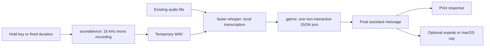

# A reproducible voice turn through gptme

This experimental skill connects audio input to one gptme CLI turn. The
file-input demo below works on a headless host. It exercises real local
transcription and a real gptme subprocess, using a deterministic offline
provider so no API credential is needed. Desktop recording and playback are
separate checks, not claims made by this demo.

## Architecture



The recording is deleted after transcription; an existing input file remains
untouched. gptme receives transcript text, not the recording. Provider locality
is determined by gptme's configuration. This script starts a fresh conversation
per invocation and has no Tauri-specific code.

## Setup

Requires Python 3.12+ and `uv`. From a gptme-contrib checkout:

```sh
cd skills/hold-to-talk
uv venv .venv
uv pip install --python .venv/bin/python -r requirements.txt \
  'gptme @ git+https://github.com/gptme/gptme.git'
. .venv/bin/activate
python3 scripts/hold-to-talk.py --help
gptme --help
```

The source install selects a gptme version with `--output-format json` and the
`mock/static` provider. The observed run below used
`gptme 0.34.0+6aa340f3`; older releases may lack these capabilities. The first
transcription downloads a Whisper model. Later runs can use the cached model.
`tiny.en` is English-only; choose another Whisper model for other languages.

Microphone input additionally needs `sounddevice` and system PortAudio.
Key-hold input also needs `pynput` and desktop keyboard access. Install those
only for the desktop modes:

```sh
uv pip install --python .venv/bin/python sounddevice pynput
```

On Debian/Ubuntu, PortAudio's runtime package is `libportaudio2`; `espeak-ng`
provides optional speech output. On macOS, `say` is built in and keyboard
monitoring may require Accessibility/Input Monitoring permission. Wayland
keyboard-hook behavior depends on the compositor; use `--duration` if the
global hold key is unavailable.

## Recorded file-input demonstration

Use your own speech WAV/FLAC, or the JFK fixture from OpenAI Whisper's test
suite. The download is speech data, not an executable. Keep demo artifacts
inside the skill's `demo-output/` directory.

```sh
mkdir -p demo-output
curl -fL https://raw.githubusercontent.com/openai/whisper/main/tests/jfk.flac \
  -o demo-output/jfk.flac
HTT_GPTME_ARGS='--no-workspace --system short --model mock/static' \
  python3 scripts/hold-to-talk.py \
  --audio-file demo-output/jfk.flac --no-tts
```

Observed on a Linux headless host on 2026-10-15, with a cached `tiny.en` model:

```text
📝 Transcribing (tiny.en)…
   [1025ms] 'And so my fellow Americans ask not what your country can do for you  ask what you can do for your country'
🤖 Asking gptme…

This is a static mock response.
```

The duration is one observation of transcription, including model loading;
it is not end-to-end latency or a performance guarantee. The final sentence
is deliberately canned: this verifies the process/JSON boundary, not model
reasoning quality. TTS was disabled and no microphone or key hook was tested.

Use `mock/static` for this smoke run. A `mock/echo` run on the observed gptme
version echoed a completion nudge on its final turn rather than the original
transcript, so it is not a reliable expected-output assertion here.

For a real response, set `HTT_GPTME_ARGS` to your configured provider/model
and repeat the command. That sends the transcript to that provider. For
example, substitute your model identifier in `--model PROVIDER/MODEL`.
Without `--no-tts`, the script uses `say`, `espeak`, or `espeak-ng` when
available; otherwise it prints the response.

## Desktop acceptance session

Run this sequence on the target machine and record actual results before
claiming the desktop mode works. The following is a test script, not an
observed transcript:

1. Run `python3 scripts/hold-to-talk.py --duration 5 --transcript-only`.
   Speak a short sentence. Check that the printed transcript matches it.
2. Run `python3 scripts/hold-to-talk.py --transcript-only`.
   Hold Space, speak, and release. Check that capture ends on release and
   that key autorepeat does not start another turn.
3. Set a configured gptme model in `HTT_GPTME_ARGS`. Run with `--duration 5
   --no-tts`; check the answer and confirm the run exits after one turn.
4. Repeat without `--no-tts`; check audible playback and transcript accuracy.
   Record OS, audio device, model, permission setup, and measured timings.
5. Run `--audio-file demo-output/jfk.flac --transcript-only` and check the
   fixture remains. A failed gptme invocation must exit nonzero with a useful
   error, not silently produce an empty response.

Tools are disabled by default. `-n` implies unattended execution in gptme;
deliberately enabling tools changes what a spoken request may do. Normal
gptme conversation logging still applies even with `--no-workspace`.

## Regression checks

These use temporary fake executables and do not require audio devices,
Whisper models, or provider credentials:

```sh
uv pip install --python .venv/bin/python pytest
python3 -m pytest tests/test_hold_to_talk.py -q
```

They cover positional prompt forwarding, shell-quoted arguments, subprocess
errors, selecting only the final assistant message, rejecting absent assistant
output, preserving supplied audio, cleaning generated recordings on failure,
and the file-input command path.
